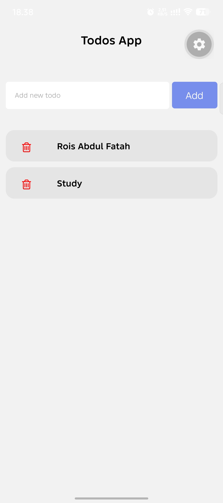
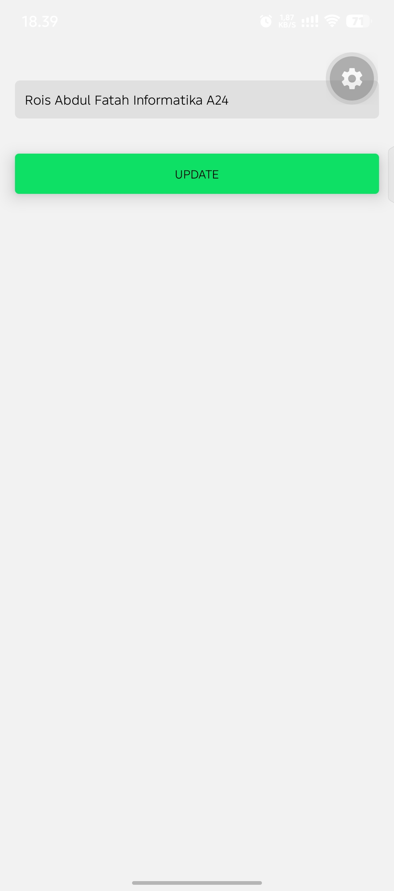
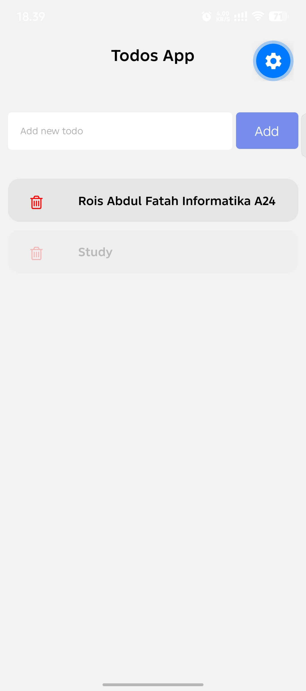
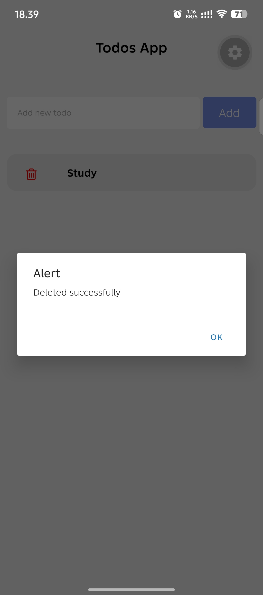

# TodosApp

Aplikasi To Do sederhana dengan fitur CRUD, dibuat memakai React Native, Expo, dan Firebase Firestore.

## Fitur

- **Create**: menambah todo baru
- **Read**: menampilkan daftar todo secara real-time, diurutkan dari yang terbaru
- **Update**: mengubah isi todo lewat halaman Detail
- **Delete**: menghapus todo dengan ikon tempat sampah

## Teknologi

- React Native
- Expo
- Firebase Firestore (v8)
- React Navigation (Stack)

## Struktur Project

```
TodosApp/
├── App.js
├── config.js
├── package.json
└── Screens/
    ├── Home.js
    └── Detail.js
```

## Cara Menjalankan

1. Clone repository:
   ```bash
   git clone https://github.com/RoisAbdulFatah/TodosApp.git
   cd TodosApp
   ```

2. Install dependensi:
   ```bash
   npm install
   ```

3. Buat project di [Firebase Console](https://console.firebase.google.com), aktifkan **Firestore Database**, lalu buat collection `todos`.

4. Isi file `config.js` dengan konfigurasi Firebase milik Anda.

5. Jalankan aplikasi:
   ```bash
   npx expo start -c
   ```

6. Scan QR code memakai aplikasi **Expo Go** di HP (HP dan PC harus satu jaringan Wi-Fi).

## Screenshot

### Daftar Todo


### Edit Todo


### Setelah Diedit


### Setelah Dihapus


### Data di Firestore


## Pembuat

Rois Abdul Fatah, Teknik Informatika, Universitas Langlangbuana
